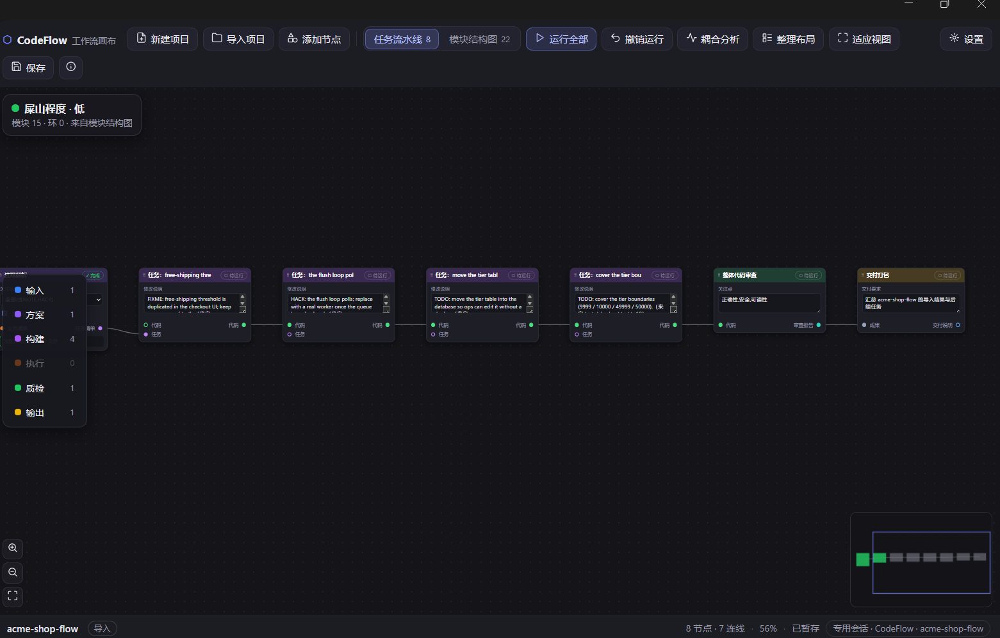
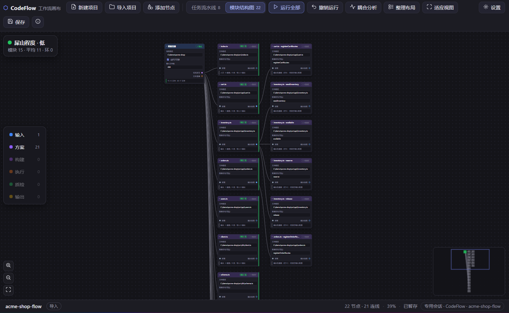
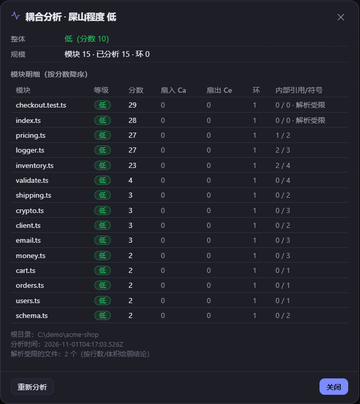
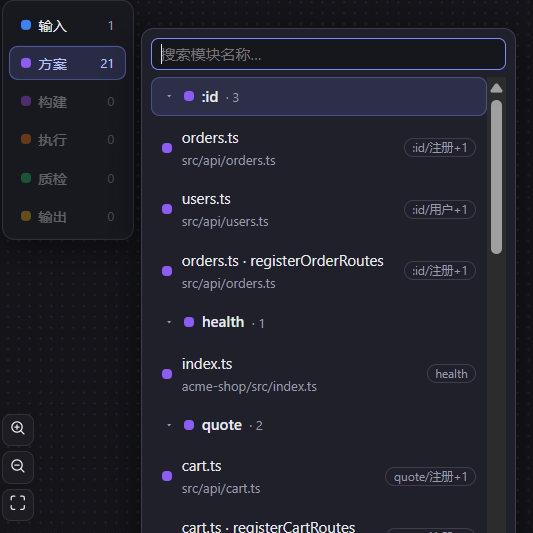

<p align="center"></p>

<h1 align="center">CodeFlow Canvas</h1>

<p align="center"><b>Turn an agent's coding work into a graph you can audit and roll back.<br/>Every node is a real task, every link a dataflow dependency, every green node evidence.</b></p>

<p align="center">
  <a href="LICENSE"></a>
  <a href="https://github.com/TheLiudawei/dsh-codeflow-canvas/actions/workflows/ci.yml"></a>
  
  
  
  
</p>

<p align="center">
  
  <br/>
  <sub>One deterministic scan of a repository produced this 8-task pipeline and its 22-module graph — zero LLM tokens.</sub>
</p>

<p align="center">
  English | <a href="README.zh-CN.md">简体中文</a>
</p>

---

CodeFlow is a coding workflow canvas for DSH (DeepSeek Harness). Import a repository and it becomes a node graph — the canvas is ComfyUI-style by design. Each node is a task the agent executes in your workspace; each link is a dependency. What makes it different is not the graph itself, but what the graph is allowed to claim.

It is a DSH plugin, ported from the ZCode plugin `codeflow-canvas` v0.2.2. The canvas editor carries over; every piece of host wiring — sessions, tool protocol, persistence, delivery, undo — was rewritten for DSH.

> UI screenshots are in Chinese because the canvas follows your DSH locale and theme. It ships with dark and light palettes and switches live with the host.

## The problem

You ask an agent to add validation to eight files. It answers "done".

Then the questions start. Which eight? Did all of them pass? What did it touch that you never asked for? If it broke something, how far back do you have to unwind? The transcript holds the answers as prose, and prose is not a diff.

## What a canvas changes

| | Planning in the transcript | CodeFlow canvas |
| --- | --- | --- |
| Where the plan comes from | Regenerated by the model on every attempt | Computed from the tree: scanning, symbol extraction, comment markers. No prompt, no tokens, no network |
| What failed, and why | You reconstruct it from the conversation | It lands on the node card, with the reason, and the node stops spinning |
| "It says it finished" | Taken on trust | A turn that ends without progress is reconciled to `failed` |
| Undoing a bad run | Manual git surgery, easy to over-reach | Snapshot before every run; one command reverts files and node state together |
| Deliverables | Scattered through the chat | Native `present` cards plus `docs/DELIVERY.md` |

## Three things the transcript cannot do

**1 · Import without a model.** `/flow-import` and the import dialog scan the tree locally — language detection, symbols, `TODO`/`FIXME` markers — and produce both a task pipeline and a module graph in seconds. Two scans of the same commit agree on every task, file and score, because nothing is invented. → `lib/importer.js`, `lib/analyst.js`, `lib/duo.js`

**2 · Undo a run, not a file.** Every `RUN_NODE` / `RUN_ALL` snapshots the project tree first (excluding `node_modules`, `dist`, `.git` …). "Undo run" restores files **and** node state together, strictly LIFO, and survives a DSH restart. The current state is backed up before anything is restored, so a restore never destroys what it overwrites. → `lib/undo.js`

**3 · A green node means something.** A node flips to `running` when the prompt is queued and only reaches `done` when the agent reports back. If the turn ends with no progress, the host marks it `failed` — "agent did not execute this node" — and offers one-click retry. Nothing is inferred from what the agent *said*. → `lib/gestures.js` (optimistic `running`), `lib/index.js` (end-of-turn reconciliation), `lib/activity.js`

## Measured, not claimed

`npm run bench` runs a fixed synthetic fixture (60 modules, 13.9 KB) through the real import command and the real undo manager, then prints this table. The fixture is generated by a pure function — same files, same content on any machine — and the run **fails** if determinism or undo stops holding, so these numbers cannot rot silently.

| measured | value |
| --- | --- |
| import (cold / warm) | ≈90 ms / ≈70 ms (65–120 ms across runs) |
| agent wakeups during import | 0 |
| prompt tokens spent on import | 0 |
| tasks / module nodes produced | 9 / 39 |
| tasks derived from TODO / FIXME / HACK | 5 |
| two independent imports agree on analysis fields | 48 / 48 |
| undo checks (byte-exact restore, added file removed, report accurate) | 4 / 4 |

Absolute timings come from the author's machine and will differ; the zeros and the agreement counts will not.

For comparison, a plan written in the transcript cannot start without the model reading the source: 13.9 KB here, **≈3.5k tokens by the chars/4 heuristic**. That line is an estimate and is labelled as one — everything else in the table is measured. Reproduce with `npm run bench` (add `--json` for machine-readable output).

## What changed in 1.4.2

- **The comparison table now has measured numbers.** `tests/bench.mjs` (run with `npm run bench`) drives a fixed 60-module fixture through the real `/flow-import` command and the real undo manager, then reports import time, agent wakeups, prompt tokens, tasks/modules produced, cross-import agreement and undo fidelity. It exits non-zero if determinism or undo stops holding, so the table cannot go stale silently.
- **What it deliberately does not measure:** what a model would spend writing the same plan in the transcript. Nobody measured that here, so the README states only a labelled lower bound (source bytes / 4) instead of inventing a saving percentage.

## What changed in 1.4.1

Documentation only — no code changed.

- **The front page now argues a position instead of describing a shape.** It opens with the problem ("it says done; which eight files, and how do you undo it?"), a five-row comparison against planning in the transcript, and three claims the transcript cannot make — each with the code file that backs it (`lib/importer.js`, `lib/undo.js`, `lib/gestures.js` + `lib/index.js`).
- **No number in that comparison is invented.** Every row is a behaviour you can read in the source, which is the point: a claim without evidence is what this plugin exists to avoid.

## What changed in 1.4.0

A visible change to the product's face — which is exactly why it gets its own version.

- **The glyph is gone; CodeFlow has a mark.** The sidebar icon, the toolbar logo and the empty state used to draw `⬡`, a text glyph that rendered differently on every platform. They now share one vector mark — a hex canvas cut by the flow channel — drawn inline by `tools/port-canvas.mjs` (toolbar 17px, empty state 46px) and in `currentColor` for the sidebar so the shell still decides hover and selected tints.
- **`assets/branding/` is the source of truth**: `logo.svg` (colour), `logo-on-light.svg`, `logo-mono.svg` (currentColor) and PNGs at 32/64/128/256/512 for stores, docs and social cards.
- **Both READMEs lead with the mark**, and `docs/images/social-preview.png` (1280×640) is ready for the repository's social card.
- **Version discipline is now enforced.** `tests/release.mjs` fails when `package.json` does not run ahead of the latest tag while there are unreleased commits — the exact situation that left a `feat` commit sitting past `v1.3.2`. It runs in CI (which now checks out with `fetch-depth: 0`) and in `npm test`.

## What changed in 1.3.2

Card identity got stricter, and two defects the CI matrix caught are fixed.

- **Only path-shaped tokens become source anchors.** The old rule accepted anything with a dot, so `v1.2.3`, `3.5`, `https://example.com/x.md` and `e.g.` all produced anchors — two unrelated cards could pair, or the same card could stop pairing after a re-import. A token now qualifies when it contains a separator or ends in a known source extension (`SOURCE_EXTENSIONS`, ~90 entries); scheme URLs, version/number patterns, abbreviations and timestamps are rejected. Five counterexamples and seven positive cases live in `tests/cards.mjs`.
- **Drifted cards drop back to `pending`.** When the source changed since the import, the old "done" is no longer evidence of the current state: the card returns to `pending` (the same rule as "not executed means failed"), keeps a note `源码已变，需重跑`, and shows an amber badge that disappears as soon as it runs again. No drift, no change.
- **`npm test` is now `tests/run-all.mjs`.** Sequential spawn, exit codes collected, one summary table with per-suite timing — aligned with CI's `if: always()`, so a failing suite never hides the rest.
- **Undo detects same-size edits.** `files.modified` was decided from size plus a 1 ms mtime tolerance; a same-size edit written within the same millisecond was reported as unchanged on Linux. `dryRun` and `restore` now fall back to comparing contents in that ambiguous case.
- **Fixture cleanup retries.** `rm(recursive)` occasionally threw `ENOTEMPTY` on macOS while the plugin's debounced persistence wrote a file back; recursive removals in `validate` go through a short-backoff retry instead of failing the run.

## What changed in 1.3.1

No feature changes — this release makes the suite trustworthy on machines that are not the author's.

- **CI runs 18 suites on three platforms.** `ubuntu-latest` / `windows-latest` / `macos-latest` × Node 22, all blocking. Every step carries `if: always()`, so one failing suite still lets the rest report — a single run shows the whole picture.
- **Fixed a real geometry bug.** `fit-popover` computed its minimum height as `Math.min(minListHeight, Math.max(minListHeight, innerH))` — identically `minListHeight` — so a short stage still demanded 96px and pushed the list past the bottom edge. It is now `Math.min(minListHeight, innerH)`, with `maxHeight` clamped to the available height; the test for that boundary actually exercises it (stage 100px, inner height 84px).
- **The tests no longer depend on the checkout.** `\n`-anchored assertions broke on CRLF checkouts (`.gitattributes` now pins LF, and the shared `read()` normalises); one assertion only held on Windows and was removed in favour of the explicit win32/POSIX pair; four `/flow-import` checks were passing only because a stale directory happened to exist in `%TEMP%`; Windows-path assertions in the workspace and browse suites now pass an explicit platform. Closes the failures reported in [#2](https://github.com/TheLiudawei/dsh-codeflow-canvas/issues/2).
- **Canvas freshness is a content hash.** The generator stamps the hash of its inputs into the canvas header (`tools/canvas-sources.mjs` is the single input list) and the button audit recomputes it, instead of comparing mtimes — which cannot work in a fresh clone.
- **`npm test`** runs all 18 suites.

## What changed in 1.3.0

- **Named menus replace the button row.** The toolbar is now `logo · 项目/运行/视图/帮助 menus · view tabs · 新建/导入/运行全部 · undo/save/settings icons` — `flex-wrap: nowrap`, no second row at any width. Menus collapse into a `☰` panel below 720px rendered **from the same model** (`lib/ui/menu.js` → `lib/ui/menu-html.js`, build-time static markup; `tools/patches/menu-ui.js` only delegates clicks to the existing handlers via one action-key table). Full keyboard support (arrows/Home/End/Esc) with `aria-haspopup`/`aria-expanded`/`role="menu"`.
- **The secondary node list always fits.** Its position/height are derived from the stage by a pure function (`lib/ui/fit-popover.js`, inlined at build time): the list scrolls to the last row at 480px height with 200 nodes, the search box stays visible, wheel scrolling no longer chains into the canvas, and the left category bar itself scrolls.
- **Task cards survive re-import (opt-in, off by default).** On first canvas open the panel asks once per workspace (`cards.asked` in `CodeFlow/config.json`). Enabled, re-importing the same project merges by stable card identity (`lib/cards/identity.js`): run state, result, position, renamed titles and edited params are preserved onto the freshly scanned graph; deleted tasks stay as「失效卡片」(excluded from run-all, cleanable from the 项目 menu); merge runs as a pure function (`lib/cards/merge.js`) and never blocks import. Disabled behaviour is byte-identical to 1.2.2 plus a `.bak-` backup.
- **Read-only log viewer.** 设置 → 查看工作日志（or the 帮助 menu）opens the plugin's `codeflow.log`: level filters, case-insensitive search, follow-tail (2s polling, stops on close), copy visible rows as raw JSONL, and 打开所在目录 with graceful 501 fallback to copying the path. Backed by `GET /api/log` (tail/rotated/level/q, path bound at wiring — request parameters cannot point it elsewhere) over `lib/logging/reader.js`.

## What changed in 1.2.2

- **Every canvas control is wired and audited.** A data manifest (`lib/ui/actions.js`, 73 controls) is the single source of truth; `tests/buttons.mjs` statically proves each control is registered and has a binding path, the injected `window.__CF_ACTION_MANIFEST__` powers an in-canvas click self-test (`tests/buttons/canvas-selftest.js`), and `tests/buttons/MANUAL-CHECKLIST.md` covers the rest. Fixed real defects the audit exposed: the **耦合分析** toolbar button never had a click listener (it was `disabled` and reachable only via context menus), the **session chip** was a focusable no-op button (now opens the session dialog), and the ✕ close button of the three drop dialogs (confirm / progress / conflict) was dead — dialog `close`/`cancel` is now handled by one delegated listener on `#cf-dialog`. A follow-up runtime defect surfaced the moment the button worked: the analysis success path called a misspelled helper (`fetchCouplingStale`), so the canvas toasted 耦合分析失败 after the host had already written the result — fixed, and `tests/buttons.mjs` now carries an undefined-symbol check that fails on any called-but-never-defined identifier.
- **Shell-in-shell imports land on the real project root.** All import channels (drop archive, drop folder, path import, dialog import) resolve the root through one conservative detector (`lib/import/root-detect.js`): strip the outer wrapper of an archive, then unwrap further only on unambiguous signals (project marker / shell-name / same-name). `proj/src` stays `proj`; markerless single-chain shells answer `400 SHELL_AMBIGUOUS` instead of inventing a wrong project; empty shells are rejected; multi-project parents keep the parent with a `multiProject` warning. 51 fixture×channel combinations are covered in `tests/import-shells.mjs`.
- **Work & error logging.** The plugin writes JSONL to `codeflow.log` next to the plugin source (5 MiB rotation, one `.1` backup, serial writes, fail-safe). It records the plugin lifecycle, imports (`import.start/root/done/…`), coupling runs, HTTP errors and canvas UI actions/errors — never prompts, source code, graph JSON or cookies/tokens (key-based redaction + truncation). The canvas batches its own events through `POST /codeflow/api/log` (whitelist `ui.action/ui.error/ui.selftest`, 64 KiB body cap, 50 events/s, 20 per batch). `CODEFLOW_LOG=off` disables it; `CODEFLOW_LOG_FILE` overrides the path. An architecture test (`tests/architecture.mjs`) pins the layering: logging/root-detect stay dependency-free, the import pipeline never touches `req/res`, and the static import graph has no cycles.

## What changed in 1.2.1

- **New projects require a real DSH workspace (Issue #1).** The new-project dialog carries a **workspace dropdown** fed by the read-only `GET /codeflow/api/workspaces` listing, plus a read-only preview of the final absolute path (`将创建到 …`) computed by the host. Requests without a `workspace` — or with one that is not a registered DSH workspace — answer `400` / `409` and create nothing on disk.
- **Workspace resolution is one explicit chain (Issue #2).** binding (store/sidecar) → project directory → session cwd, each matched against the workspace registry (longest prefix); anything unresolvable is a hard error with the candidate list. The old `registry.list()[0]` fallback — the "workspace wandering" culprit — is gone.
- **Canvas sessions join the workspace.** When the host exposes workspace entities, the dedicated session is created with `workspaceId` and attached to the workspace group, so it no longer shows up under「未分组」.
- **Import gained a directory-tree picker.** The import dialog has a **浏览…** button backed by the read-only `GET /codeflow/api/browse` (directories only, no symlink following, 500-entry cap, 5 s timeout). Keyboard-first: ↑/↓ select, Enter enters, Backspace goes up, Esc closes the picker first. The dialog shows both 将扫描 (source dir) and 项目文件保存在 (the workspace the graph lands in).

## Screenshots

<table>
<tr>
<td width="50%"><br/><sub><b>Module graph.</b> Every file becomes a node; each carries a 低/中/高 coupling badge (low / medium / high).</sub></td>
<td width="50%"><br/><sub><b>Coupling detail.</b> Per-module score, fan-in Ca, fan-out Ce, cycles and symbol counts — deterministic and reproducible.</sub></td>
</tr>
<tr>
<td width="100%" colspan="2"><br/><sub><b>Navigation.</b> Click a module category to open a searchable two-level list; ↑/↓/Enter to jump and zoom to a node.</sub></td>
</tr>
</table>

## Key capabilities

- **Dual views, one import.** A single scan produces both a **task pipeline** (`workflow.json`) and a **module graph** (`workflow.modules.json`). Switch with the toolbar segmented control — no rescan, no re-analysis, no agent wake-up. Nodes, coordinates, run states and `rev` are fully independent per view.
- **Coupling analysis (v1.2).** Score each file-level module for internal and external coupling: `score = round(0.6 × intra + 0.4 × inter)`, graded at fixed thresholds of 30 and 60. The canvas shows a per-node badge and an overall 「屎山程度」(codebase messiness) card with a full per-module table. All constants are exported and unit-tested; the same source scores byte-identically twice.
- **Feature index (v1.1).** Builds a deterministic `feature → file → node` map in `features.json` next to the graph: design-doc parsing, entry signals, top-level symbols, directory/file dictionaries. Zero model calls; a `manual` section always wins and survives rebuilds.
- **Drag-and-drop import (v1.2).** Drop a folder or an archive on the canvas. Folders upload recursively through a staging area and land via a single rename; `zip` / `tar` / `tar.gz` are parsed in pure Node, `7z` / `rar` fall back to system tools.
- **Real execution, visible while it runs.** Node cards show the current action, a reasoning excerpt, step count and elapsed time; a collapsible monitor tracks the run. When the model provides no reasoning stream, it degrades to a step summary — never invented.
- **Un-executed means failed.** Run requests are self-contained (target node, upstream results, working directory, acceptance criterion). If a turn ends without the agent reporting progress, the host marks the node `failed` and offers one-click retry.
- **Native delivery.** A `deliver` node collects upstream artifacts, writes `docs/DELIVERY.md` and calls DSH's native `present`, so deliverables show up as real cards in the session — not as a list inside the canvas.
- **Per-run undo.** The project tree is snapshotted before each run. Undo a whole run (files + node states), strictly LIFO, surviving restarts; the current state is backed up first.
- **Dedicated session per project.** Each project owns one persistent session (`CodeFlow · <project>`); canvas runs go only there, and DSH's active session is never hijacked.
- **Edits highlight modules.** When the agent really writes a file (from `edit`/`write`/`apply_patch` tool arguments — never guessed from prose), the matching module pulses and the card gets a badge.
- **16 node types, typed ports.** Links are validated by port type (`text` / `json` / `code` / `report` / `file` / `any`); editing parameters resets downstream nodes.
- **Zero build, zero dependencies.** `package.json` has no runtime dependencies. Host half is plain ESM; the browser half is a hand-written `__ModuleLoader__` bundle.

## Get started

```bash
# Install from a local directory — no build step
dsh plugin --profile desktop add link:<absolute path to this checkout>
```

Or install the local directory from **Settings → Plugins**, then **restart DSH** (the host half does not hot-reload) and refresh the page.

Verify it is live:

```bash
curl -i http://127.0.0.1:<port>/codeflow/canvas   # expect 200 + HTML
```

A 404 with no `codeflow` entry under `profiles/<profile>` means the plugin was not installed into that profile — re-run the install command above and restart.

**Requirements:** DSH desktop with a `sessionController` (for runs). Without it the canvas still edits, imports and saves, but running a node reports a clear error instead of binding a random session.

## Usage

| Entry | What it does |
| --- | --- |
| `/flow` | Open the canvas (loads the most recent project); with an argument, create a project from that requirement |
| `/flow-new [requirement]` | Create a project directly |
| `/flow-import <path>` | Import a project: the host scans it and produces both graphs in seconds, bypassing the agent. Accepts `@`-picked paths, `~`, quotes and `file://` |
| `codeflow_canvas` tool | The agent's write-back channel: `load` (re-read a view's graph from disk — preferred), `render` (fallback), `read`, `save`, `progress` (dedicated session only). `view: "tasks" \| "modules"` selects the view |
| Skill `codeflow-canvas` | The agent's orchestration contract (create / run / write back / deliver); `/flow*` attaches it automatically |
| `node lib/importer.js <path>` | Standalone CLI import — both graphs, no DSH running |

### Run a node

Right-click a node → **Run**, or **Run all** in the toolbar. The host snapshots the project, hands a self-contained `[CodeFlow:RUN_NODE]` message to the project's dedicated session, and flips the node to `running` immediately. The agent executes and reports progress; the card updates as it goes.

## How it works

```
Browser (panel iframe)
  ├── GET  /codeflow/canvas          host assembles the fragment + __CF_BOOT__
  ├── GET  /codeflow/api/state       poll; a newer rev replaces the graph of that view
  ├── POST /codeflow/api/state       autosave (expectedRev conflict detection → 409)
  ├── POST /codeflow/api/view        switch active view (no rev bump, no scan)
  ├── POST /codeflow/api/save        persist both views (507 + ok:false on failure)
  ├── POST /codeflow/api/import      deterministic scan → task pipeline + module graph
  ├── POST /codeflow/api/action      run / create → snapshot, then deliver [CodeFlow:*]
  ├── POST /codeflow/api/session     create or rebind the project's dedicated session
  ├── GET  /codeflow/api/workspaces  registered workspace list (read-only; feeds the new-project dropdown)
  ├── GET  /codeflow/api/browse      read-only directory listing for the import picker (dirs only, no links)
  ├── GET  /codeflow/api/activity    reasoning stream, steps, progress, file edits (memory only)
  ├── GET/POST /codeflow/api/undo    run history / restore (LIFO, shared across views)
  └── GET/POST /codeflow/api/config  project root: global root + per-project override
                                        ↓
          agent executes per the skill → codeflow_canvas (progress / load / render)
                                        ↓
  store.js (per-view rev) + paths.js (the only place project paths are assembled)
  sessions.js (bindings) + activity.js (in-memory traces) + undo.js (.undo/ snapshots)
```

Design constraints worth knowing:

1. **The canvas runs in an iframe.** It binds `keydown` (Delete, Space) and pointer events on `window`; inside the host document it would steal keystrokes from the input box.
2. **The host owns `rev`, per view.** Writing one view never bumps the other, so editing a task graph is not interrupted by a background module update.
3. **Whole graphs never travel through tool arguments.** The agent edits the graph file and calls `load`; oversized nested JSON in tool calls trips `tool input is invalid JSON` and kills the turn.
4. **Trace data lives in memory.** Ring buffers per project (≤500 entries / 256 KB), never persisted, never logged.
5. **Undo only touches the snapshot scope.** `node_modules`, `dist`, `.git` and friends can never be reverted by accident.
6. **One writer per binding.** `sessions.js` is the only component that creates or rebinds project sessions.

## Project layout

Projects live under `<workspace>/CodeFlow/flow-projects/<project>/` (`workflow.json`, `workflow.modules.json`, `view.json`, `features.json`, `session.json`). The workspace itself is never created by the plugin: **new projects pick one of DSH's registered workspaces** and the canvas session is attached to it (when the host exposes workspace entities). The root is configurable — toolbar **⚙ Settings** sets a global root and optional per-project overrides, stored in `<workspace>/CodeFlow/config.json` so it stays discoverable per workspace. Legacy `<workspace>/flow-projects/` data migrates on first resolve; conflicts are never overwritten and failures keep the old directory. Workspace resolution follows one explicit chain — **binding → project directory → session cwd**, all matched against the registry (longest prefix) — and a project whose workspace cannot be resolved reports an actionable error with the candidate list instead of silently landing somewhere else.

```
lib/core/                 fsio / path / text primitives (atomic write, tolerant JSON, bounded reads)
lib/scan/                 walk / comments / symbols — the shared scanning layer
lib/features/             six slices behind features.js (detect, dictionary, index-file, apply, map, ops)
lib/http/                 respond / context / canvas / state / import / features / project / workspace / browse routes
lib/paths.js              the single place that assembles project paths
lib/workspace-binding.js  workspace resolution (B1 chain) + registry adapter (the only registry reader)
lib/browse.js             read-only directory listing (pure functions + fs adapter)
lib/store.js              dual-view graph state, per-view rev, sanitizing
lib/coupling.js           coupling algorithm (constants exported for tests)
lib/importer.js           deterministic import (task pipeline) + CLI
lib/analyst.js            structure analysis (module graph)
lib/routes.js             thin router assembly
lib/index.js              plugin entry — pure assembly
assets/canvas/            canvas.html (generated by tools/port-canvas.mjs — do not hand-edit)
assets/skill/             skill docs + four references
tests/                    validate / regression / e2e / undo / coupling / features / drop-import / workspace / browse / contrast
```

## Development

```bash
# All 18 suites, in one go (plain Node; DSH does not need to be running)
npm test

# Or one at a time — the same command works with the DSH binary as the runtime
node tests/validate.mjs
ELECTRON_RUN_AS_NODE=1 "<DeepSeek Harness.exe>" tests/validate.mjs

# Regenerate the canvas after editing the port script (never hand-edit the output)
ELECTRON_RUN_AS_NODE=1 "<DeepSeek Harness.exe>" tools/port-canvas.mjs

# Loading-contract check for the client bundle
ELECTRON_RUN_AS_NODE=1 "<DeepSeek Harness.exe>" tools/verify-client-bundle.mjs .
```

Changing `lib/*.js` requires a DSH restart; changing `lib/client.js` requires a page refresh.

### What CI actually covers

[`.github/workflows/ci.yml`](.github/workflows/ci.yml) runs **18 suites on Ubuntu, Windows and macOS** (Node 22), blocking on all three. Between them:

| Area | Suite |
| --- | --- |
| Structure, routes, tools, canvas asset, XSS | `validate` (184 checks) |
| Per-fix regressions (B2–B9, concurrency, atomic writes) | `regression` |
| Re-import merge, stale cards, opt-out path | `cards` |
| Menu model, ARIA, build-time render, popover geometry | `menu` |
| Layering and acyclic static imports | `architecture` |
| Log schema, redaction, rotation, degrade path | `logging` |
| Run snapshots, LIFO, cross-view restore | `undo` |
| Coupling score determinism and persistence | `coupling` |
| Feature index build and rebuild stability | `features` |
| Workspace resolution chain | `workspace` |
| Read-only directory listing caps and timeouts | `browse` |
| Conservative import-root detection (51 combos) | `import-shells` |
| Log viewer filter/search/follow/path binding | `log-viewer` |
| Folder/archive staging, extraction, collisions | `drop-import` |
| Real HTTP server + fetch scenarios | `e2e` |
| Control manifest, bindings, action audit | `buttons` |
| Version discipline: `package.json` runs ahead of the latest tag | `release` |
| Measured benchmark: import cost, determinism, undo fidelity | `bench` |

**What is *not* automated** — and is not claimed to be:

- **Anything needing a running DSH host**: real session creation, actual agent execution, live reasoning streams, native `present` delivery, theme following the OS. The suites use fake hosts; the contract is tested, the integration is not.
- **Real browser behaviour in the panel iframe**: IME composition, trackpad pinch-zoom, the Space/Delete keydown handlers, native drag-and-drop from Finder/Explorer. `tests/mac/` is a **manual diagnostic kit** for exactly this (see its README) — it needs an installed DSH and a human.
- **Archive formats delegated to system tools**: `7z` and `rar` are only exercised where the tool exists; `zip`/`tar`/`tar.gz` are parsed in pure Node and are covered.
- **`tests/contrast.mjs`** is a module imported by other suites (WCAG audit of the light palette), not a standalone suite.
- **Canvas freshness** is a *content* hash, not mtime: the generator stamps the hash of its inputs into the canvas header (`tools/canvas-sources.mjs` is the single list) and `buttons` recomputes it, so a stale artifact is caught in a fresh checkout too.

## Differences from the ZCode version

| ZCode v0.2.2 | This plugin |
| --- | --- |
| `::visualize{}` Gen UI embedded in the conversation | Native sidebar panel (iframe) |
| Agent generates the canvas HTML | Host assembles the document; the agent only submits the graph |
| `window.zcode.sendFollowUpMessage` | `POST /codeflow/api/action` → dedicated session |
| `setWidgetState` (16 KiB cap) | Host state + disk, no cap |
| `widgetState.rev` comparison | Host owns `rev`, per view |
| Markdown command files | Real commands via `ctx.commands.register` |
| `.zcode-plugin/plugin.json` | `package.json` + `cordis.patch.yml` |
| Dark only | Dark + light palettes following DSH |
| — | Dedicated sessions, live traces, native delivery, run undo, coupling, feature index, drag-and-drop import |

## Known limitations

- **New projects require a registered workspace.** A directory DSH has not registered cannot host a new project — the plugin refuses with the candidate list (no silent downgrade registration, no writes into DSH's workspace records); add it in DSH's sidebar first.
- **Import needs a resolvable workspace for the graph files.** The source directory can be anywhere on disk, but the graph lands under the current workspace; with nothing bound yet (fresh install, no project) import reports what to do instead of guessing a location.
- **The browse picker lists directories only.** No files, no sizes, no contents; symlinks and junctions are never followed or listed; 500 entries per level and a 5 s timeout guard slow or disconnected network shares. Windows reparse tags beyond symlinks/junctions are not enumerable without native code.
- **Edit highlighting trusts only real write tools.** Writes through `shell` redirection or indirect scripts are out of scope and not guessed at.
- **Only files in a graph are highlighted.** A file outside the module graph gets a one-time notice instead of a fabricated highlight.
- **Edit records are memory-only.** Markers disappear on host restart; they never enter `workflow.json` or logs.
- **Undo covers the project root only.** Writes outside it, and excluded directories, are not restored. Because undo is strictly LIFO, a newest run without a snapshot blocks undoing older ones.
- **`.undo/` holds source copies** (≤10 runs / 1 GB, local only, never exposed by any route). Delete the project directory to clear it.
- **Switching views needs both graphs.** If module analysis fails (almost no source), import produces the task pipeline alone and the switcher hides — task nodes are never passed off as modules.
- **Graph sync is polling** (~1.8 s; traces ~0.85 s while running and visible), not streaming.
- `shell` nodes can run arbitrary commands; the skill asks the agent to confirm first, nothing more.

## License

[MIT](LICENSE) © TheLiudawei
