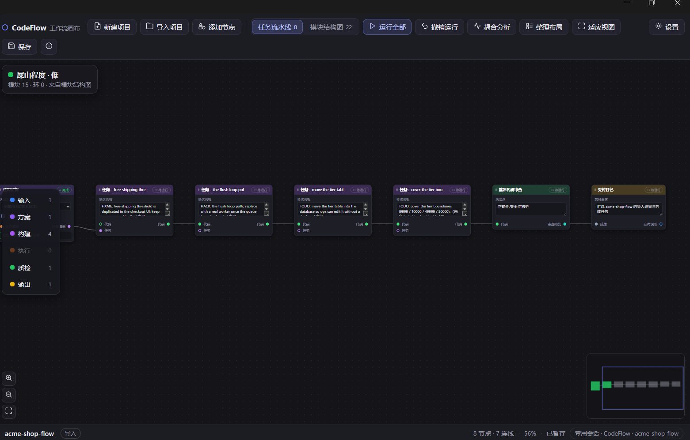
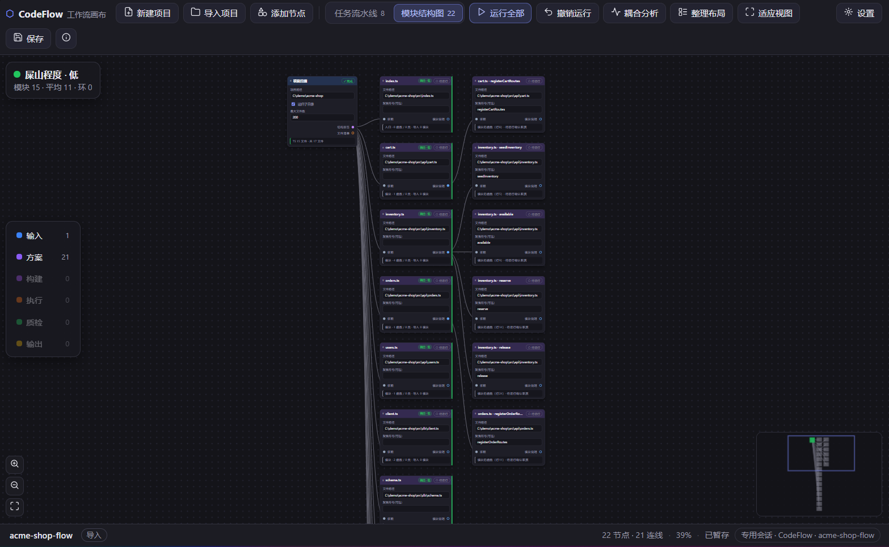
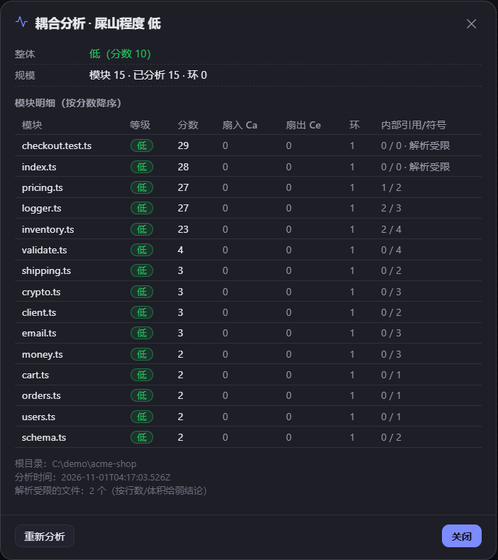
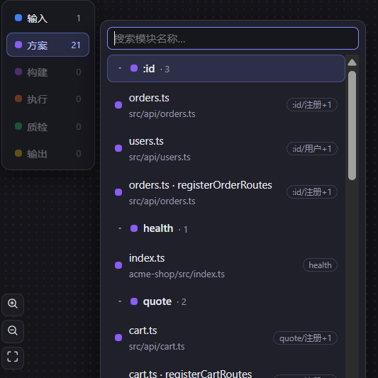

<h1 align="center">CodeFlow 工作流画布</h1>

<p align="center"><b>DSH 上的 ComfyUI 风格编程工作流画布。<br/>每个节点都是一个 agent 真实执行的任务，每条连线都是一条数据流依赖。</b></p>

<p align="center">
  <a href="LICENSE"></a>
  
  
  
  
</p>

<p align="center">
  
  <br/>
  <sub>一次确定性扫描，同时产出这条 8 节点任务流水线和 22 个模块的结构图——零 LLM token。</sub>
</p>

<p align="center">
  <a href="README.md">English</a> | 简体中文
</p>

---

平时你在对话里排计划，然后往下翻。CodeFlow 把计划从对话里拎出来放到画布上：任务是可拖动的节点卡片，依赖是真实的连线，agent 在工作区里逐个执行，再把结果写回卡片。

它是 DSH（DeepSeek Harness）插件，从 ZCode 插件 `codeflow-canvas` v0.2.2 迁移而来。画布编辑器沿用原实现；会话、工具协议、持久化、交付、撤销这一整套宿主接线全部为 DSH 重写。

> 截图是中文界面——画布跟随 DSH 的语言与主题。它自带深/浅两套调色板，随宿主实时切换。

## 为什么用画布

- **图能审，聊天记录不能。** 计划、顺序、卡在哪一步，一眼看完。
- **导入不花钱。** 扫描、符号提取、耦合评分、功能归属全是本地确定性计算——不调模型、不联网、不依赖 npm 包。
- **不伪造。** 只有 agent 真的执行并回报了，节点才会变绿；没执行的节点会被对账为 `failed`，不会永远转圈。

## 1.3.0 变更

- **顶栏重构为「命名菜单 + 主操作」布局。** 现在是 `logo · 项目/运行/视图/帮助 · 视图 tab · 新建/导入/运行全部 · 撤销/保存/设置图标`，`flex-wrap: nowrap`——任何宽度都不换行；<720px 时四个菜单收进 `☰` 分组面板，**折叠态与展开态出自同一份模型**（`lib/ui/menu.js` → `lib/ui/menu-html.js` 构建期渲染成静态标记；`tools/patches/menu-ui.js` 只做事件委托，经一张 action key → 现有函数的查表复用同一份处理逻辑）。全键盘可用（↑/↓/Home/End/Esc），ARIA 完整。
- **二级节点列表永远完整落在画布内。** 位置与高度由纯函数 `lib/ui/fit-popover.js`（构建期内联，单一实现）按 stage 可用空间反推：480px 高度 + 200 节点也能滚到最后一行，搜索框始终可见，列表滚轮不再带动画布缩放，左侧分类栏自身也可滚动。
- **任务卡片重新导入不丢失（默认关闭）。** 首次打开画布按工作区询问一次（`cards.asked` 写入 `CodeFlow/config.json`）。开启后重新导入同一项目按稳定标识合并（`lib/cards/identity.js`）：运行状态、结果、位置、改过的标题/参数都附着到新扫描的图上；源码中已删除的任务保留为「失效卡片」（不参与运行全部，可从项目菜单一键清理）；合并是纯函数（`lib/cards/merge.js`），失败只警告绝不阻断导入。关闭时行为与 1.2.2 一致（覆盖 + `.bak-` 备份）。
- **设置里可看工作日志。** 设置 → 查看工作日志（或「帮助」菜单）打开只读查看器：级别过滤、大小写不敏感搜索、跟随尾部（2 秒轮询，关闭即停）、复制可见原始 JSONL 行、打开所在目录（宿主无能力时降级为复制路径并明确提示）。底层是 `GET /api/log`（tail/rotated/level/q；文件路径在装配时绑定，请求参数指不到别处）与 `lib/logging/reader.js`。

## 1.2.2 变更

- **画布所有可点击控件都有清单、有绑定、有审计。** 数据清单 `lib/ui/actions.js`（73 个控件）是单一事实来源：`tests/buttons.mjs` 静态证明每个控件都登记且至少有一条绑定路径；生成器注入的 `window.__CF_ACTION_MANIFEST__` 供画布内真实点击自检脚本（`tests/buttons/canvas-selftest.js`）使用；其余路径由 `tests/buttons/MANUAL-CHECKLIST.md` 逐项验收。审计揪出并修复了四个真实缺陷：**「耦合分析」工具栏按钮从未绑过 click**（HTML 里 disabled、只能从右键进入，永远点不动）；**会话 chip 是可聚焦但无动作的假按钮**（现在点开「画布专用会话」）；**拖拽确认/进度/冲突三个对话框的 ✕ 是死按钮**——对话框的 close/cancel 现在由 `#cf-dialog` 上的一次事件委托统一兜底。 按钮修好后立即暴露出下一个潜伏缺陷：分析**成功后**的刷新链调用了一个拼错的函数名（`fetchCouplingStale`），宿主已写图成功、画布却弹「耦合分析失败」——已修复，且 `tests/buttons.mjs` 新增 undefined-symbol 检查：任何被调用却从未定义的标识符直接红。
- **外壳套外壳的导入找到真实项目根。** 三条导入通道（拖拽压缩包、拖拽文件夹、路径/对话框导入）都走同一个保守根解析器（`lib/import/root-detect.js`）：压缩包先按既有语义剥最外层，之后只有「项目标记 / 明显外壳名 / 与父同名」才继续下钻。`proj/src` 必须保留 `proj`；无标记的单链外壳直接 `400 SHELL_AMBIGUOUS`，绝不生成项目名/根目录错误的项目；空壳 400；多项目父目录保留父目录并记 `multiProject` 警告。`tests/import-shells.mjs` 覆盖 51 个「夹具 × 通道」组合。
- **工作与报错日志。** 插件在安装目录写 JSONL 文件日志 `codeflow.log`（5 MiB 轮转、保留一个 `.1`、串行写、失败降级不崩）：记录插件生命周期、导入（`import.start/root/done/…`）、耦合分析、HTTP 错误与画布 UI 动作/报错——绝不记录提示词、源码、图 JSON、Cookie/Token（按键名脱敏 + 截断）。画布侧通过 `POST /codeflow/api/log` 批量上报（白名单 `ui.action/ui.error/ui.selftest`、64 KiB 上限、50 条/秒、单批 20 条）。`CODEFLOW_LOG=off` 关闭；`CODEFLOW_LOG_FILE` 覆盖路径。新增架构测试（`tests/architecture.mjs`）钉住分层：logging/root-detect 零领域依赖、导入管道不接触 `req/res`、静态 import 图无环。

## 1.2.1 变更

- **新建项目必须先选真实存在的 DSH 工作区（Issue #1）。** 新建对话框新增**工作区下拉**（数据来自只读的 `GET /codeflow/api/workspaces`），下方只读预览最终绝对路径（`将创建到 …`，由宿主计算）。请求缺 `workspace`、或所选目录不是已登记工作区时，直接 `400` / `409`，磁盘上什么都不多出来。
- **工作区寻址只剩一条显式链（Issue #2）。** 绑定（store/侧车）→ 项目目录 → 会话 cwd，逐档对工作区注册表做最长前缀匹配；解析不出就硬失败并给出候选清单。旧的「注册表第一个工作区」回退——「乱窜」的根源——已删除。
- **画布会话真正归属工作区。** 宿主提供工作区实体时，专用会话以 `workspaceId` 创建并被 attach 进该工作区分组，不再落进「未分组」。
- **导入新增目录树选择器。** 导入对话框路径框右侧新增**浏览…**，底层是只读的 `GET /codeflow/api/browse`（只列目录、不跟符号链接、单层 500 项、5s 超时）。键盘优先：↑/↓ 选择、Enter 进入、Backspace 上一级、Esc 先关选择器。对话框同时显示「将扫描」（源码目录）与「项目文件保存在」（图文件的工作区落点）。

## 截图

<table>
<tr>
<td width="50%"><br/><sub><b>模块结构图。</b>每个文件一个节点，各自带 低/中/高 耦合徽章。</sub></td>
<td width="50%"><br/><sub><b>耦合详情。</b>逐模块分数、扇入 Ca、扇出 Ce、成环与符号数——确定性、可复现。</sub></td>
</tr>
<tr>
<td width="100%" colspan="2"><br/><sub><b>导航。</b>点模块分类弹出可搜索的二级列表；↑/↓/Enter 选中并缩放定位。</sub></td>
</tr>
</table>

## 核心能力

- **双视图、一次导入。** 一次扫描同时产出**任务流水线**（`workflow.json`）与**模块结构图**（`workflow.modules.json`）。工具栏分段控件随时切换——不重扫、不重分析、不唤醒 agent。两个视图的节点、坐标、运行状态与 `rev` 完全独立。
- **耦合分析（v1.2）。** 为每个文件级模块计算内部/外部耦合：`score = round(0.6 × intra + 0.4 × inter)`，按固定阈值 30 / 60 分级。画布上每个节点带徽章，左上角一张整体「屎山程度」卡片，点开是逐模块表格。算法常量全部导出并可单测；同一份源码两次分析结果逐字节一致。
- **功能归属索引（v1.1）。** 在图文件旁边生成 `features.json`，把「功能 → 文件 → 节点」做成确定性映射：解析设计文档、入口信号、顶层符号、目录/文件名词典。零模型调用；`manual` 段永远优先，且重建时原样保留。
- **拖拽导入（v1.2）。** 把文件夹或压缩包拖到画布上即可导入。文件夹走递归上传 + 暂存区一次 rename 落地；`zip` / `tar` / `tar.gz` 用纯 Node 解析，`7z` / `rar` 降级到系统工具。
- **执行过程可见。** 运行中的节点卡片显示当前动作、思考摘录、步骤数与耗时；右上角有可折叠监视器。模型不给 reasoning 流时降级为步骤摘要——绝不编造。
- **没执行就是失败。** 运行请求自包含（目标节点、上游结果、工作目录、验收标准）。回合结束时 agent 没有回报进度，宿主直接把节点置 `failed` 并给出一键重试。
- **原生交付。** `deliver` 节点收集上游产物、写 `docs/DELIVERY.md`、调用 DSH 原生 `present`，交付物在会话里是真实卡片，而不是画布里的一个清单。
- **按次撤销。** 每次运行前快照项目源码树。可整次回退（文件 + 节点状态），严格 LIFO，DSH 重启后仍可用；恢复前先备份当前状态。
- **每项目专用会话。** 每个项目一个持久会话（`CodeFlow · <项目>`），画布的运行只进该会话，不会劫持 DSH 当前会话。
- **改代码高亮模块。** agent 真的写了文件时（从 `edit`/`write`/`apply_patch` 等工具参数提取，绝不猜对话文本），对应模块脉冲高亮并挂上徽章。
- **16 种节点、端口有类型。** 连线按端口类型校验（`text` / `json` / `code` / `report` / `file` / `any`）；改参数会自动重置下游。
- **零构建、零依赖。** `package.json` 没有任何运行时依赖。宿主半侧是普通 ESM，浏览器半侧是手写的 `__ModuleLoader__` bundle。

## 安装

```bash
# 从本地目录安装 —— 不需要构建
dsh plugin --profile desktop add link:<本目录的绝对路径>
```

或在「设置 → 插件」里安装本地目录，然后**重启 DSH**（宿主半侧不参与热重载）并刷新页面。

确认是否生效：

```bash
curl -i http://127.0.0.1:<端口>/codeflow/canvas   # 期望 200 + HTML
```

如果返回 404，且 `profiles/<profile>` 下 grep 不到 `codeflow`，说明插件没装进该 profile——重新执行上面的安装命令并重启。

**前提：** DSH 桌面端提供 `sessionController`（运行节点需要）。没有它，画布仍可编辑、导入、保存，但运行会给出明确错误，而不是随便绑一个会话。

## 用法

| 入口 | 作用 |
| --- | --- |
| `/flow` | 打开画布（载入最近项目）；带参数时按该需求建项目 |
| `/flow-new [需求]` | 直接新建项目 |
| `/flow-import <路径>` | 导入项目：宿主扫描并秒级产出两张图，不经过 agent。支持 `@` 选择、`~`、引号与 `file://` |
| `codeflow_canvas` 工具 | agent 的回填通道：`load`（从磁盘重读该视图的图，首选）、`render`（后备）、`read`、`save`、`progress`（仅专用会话）。`view: "tasks" \| "modules"` 指定视图 |
| 技能 `codeflow-canvas` | agent 的编排契约（新建/运行/回填/交付）；`/flow*` 会自动带上 |
| `node lib/importer.js <路径>` | 命令行独立导入——两张图，不需要 DSH 在跑 |

### 运行一个节点

右键节点 →「运行」，或工具栏「运行全部」。宿主先快照项目，把自包含的 `[CodeFlow:RUN_NODE]` 消息投给该项目的专用会话，并立即把节点置为 `running`。agent 执行并回报进度，卡片随之更新。

## 工作原理

```
浏览器（面板 iframe）
  ├── GET  /codeflow/canvas          宿主组装片段 + __CF_BOOT__
  ├── GET  /codeflow/api/state       轮询；rev 变大则替换该视图的图
  ├── POST /codeflow/api/state       自动暂存（expectedRev 冲突 → 409）
  ├── POST /codeflow/api/view        切换激活视图（不 bump rev、不扫描）
  ├── POST /codeflow/api/save        双视图落盘（失败 507 + ok:false）
  ├── POST /codeflow/api/import      确定性扫描 → 任务流水线 + 模块结构图
  ├── POST /codeflow/api/action      运行/新建 → 快照，再投递 [CodeFlow:*]
  ├── POST /codeflow/api/session     新建或重建项目的专用会话
  ├── GET  /codeflow/api/workspaces  已登记工作区清单（只读；新建下拉的数据源）
  ├── GET  /codeflow/api/browse      只读目录浏览（导入选择器；只列目录、不跟链接）
  ├── GET  /codeflow/api/activity    思考流、步骤、进度、文件编辑（纯内存）
  ├── GET/POST /codeflow/api/undo    运行历史 / 恢复（LIFO，跨视图共用）
  └── GET/POST /codeflow/api/config  项目根：全局根 + 单项目覆盖
                                        ↓
          agent 按技能执行 → codeflow_canvas（progress / load / render）
                                        ↓
  store.js（按视图的 rev）+ paths.js（唯一的项目路径拼装点）
  sessions.js（会话绑定）+ activity.js（内存过程缓冲）+ undo.js（.undo/ 快照）
```

几个关键取舍：

1. **画布跑在 iframe 里。** 它在 `window` 上挂了 `keydown`（Delete、空格）与指针事件；放进宿主文档会抢走输入框按键。
2. **`rev` 归宿主管、按视图独立。** 写一个视图永远不会 bump 另一个视图，在任务图里编辑不会被模块图的后台更新打断。
3. **整图不经工具参数搬运。** agent 改图文件后调 `load`；超长嵌套 JSON 塞进工具调用会触发 `tool input is invalid JSON`，直接毁掉整个回合。
4. **过程数据只在内存。** 每项目环形缓冲（≤500 条 / 256 KB），不落盘、不进日志。
5. **撤销只碰快照范围。** `node_modules`、`dist`、`.git` 之类永远不会被误删。
6. **绑定只有一个写者。** `sessions.js` 是唯一创建/重绑项目会话的组件。

## 项目目录

项目落在 `<工作区>/CodeFlow/flow-projects/<项目名>/`（`workflow.json`、`workflow.modules.json`、`view.json`、`features.json`、`session.json`）。**工作区本身由用户选定**：新建项目必须从 DSH 已登记的工作区里挑一个，插件绝不创建、不登记工作区根目录；宿主提供工作区实体时，画布专用会话一并归属该工作区。根目录可配置——工具栏 **⚙ 设置**里设全局根，也可以给单个项目覆盖，配置存在 `<工作区>/CodeFlow/config.json`，换根之后仍按工作区可发现。旧版 `<工作区>/flow-projects/` 数据首次解析时自动迁移；冲突不覆盖，失败保留旧目录。工作区解析只走一条显式链——**绑定 → 项目目录 → 会话 cwd**，逐档对注册表做最长前缀匹配；解析不出就报错并给候选清单，绝不悄悄落到别处。

```
lib/core/        fsio / path / text 基础层（原子写、宽容 JSON、有界读）
lib/scan/        walk / comments / symbols —— 共享扫描层
lib/features/    features.js 背后的六片职责子包（detect、dictionary、index-file、apply、map、ops）
lib/http/        respond / context / canvas / state / import / features / project / workspace / browse 路由
lib/paths.js     唯一的项目路径拼装点
lib/workspace-binding.js  工作区解析（B1 链）+ 注册表适配器（全插件唯一读注册表的地方）
lib/browse.js    只读目录浏览（纯函数 + fs 适配）
lib/store.js     双视图图状态、按视图的 rev、清洗
lib/coupling.js  耦合算法（常量导出供测试）
lib/importer.js  确定性导入（任务流水线）+ CLI
lib/analyst.js   结构分析（模块结构图）
lib/routes.js    薄路由装配
lib/index.js     插件入口 —— 纯装配
assets/canvas/   canvas.html（由 tools/port-canvas.mjs 生成，勿手改）
assets/skill/    技能文档 + 四份 references
tests/           validate / regression / e2e / undo / coupling / features / drop-import / workspace / browse / contrast
```

## 开发

```bash
# 自检（不需要 DSH 在跑）
ELECTRON_RUN_AS_NODE=1 "<DeepSeek Harness.exe>" tests/validate.mjs
ELECTRON_RUN_AS_NODE=1 "<DeepSeek Harness.exe>" tests/regression.mjs
ELECTRON_RUN_AS_NODE=1 "<DeepSeek Harness.exe>" tests/e2e.mjs
ELECTRON_RUN_AS_NODE=1 "<DeepSeek Harness.exe>" tests/undo.mjs
ELECTRON_RUN_AS_NODE=1 "<DeepSeek Harness.exe>" tests/coupling.mjs
ELECTRON_RUN_AS_NODE=1 "<DeepSeek Harness.exe>" tests/features.mjs
ELECTRON_RUN_AS_NODE=1 "<DeepSeek Harness.exe>" tests/drop-import.mjs
ELECTRON_RUN_AS_NODE=1 "<DeepSeek Harness.exe>" tests/workspace.mjs
ELECTRON_RUN_AS_NODE=1 "<DeepSeek Harness.exe>" tests/browse.mjs

# 改了迁移脚本后重新生成画布（不要手改生成物）
ELECTRON_RUN_AS_NODE=1 "<DeepSeek Harness.exe>" tools/port-canvas.mjs

# 客户端 bundle 的加载契约校验
ELECTRON_RUN_AS_NODE=1 "<DeepSeek Harness.exe>" tools/verify-client-bundle.mjs .
```

改 `lib/*.js` 需要重启 DSH；改 `lib/client.js` 刷新页面即可。

## 与 ZCode 版的差异

| ZCode v0.2.2 | 本插件 |
| --- | --- |
| `::visualize{}` 会话内嵌 Gen UI | 侧边栏原生面板（iframe） |
| agent 生成画布 HTML | 宿主组装文档，agent 只提交图 |
| `window.zcode.sendFollowUpMessage` | `POST /codeflow/api/action` → 专用会话 |
| `setWidgetState`（16 KiB 上限） | 宿主状态 + 落盘，无上限 |
| `widgetState.rev` 比较 | 宿主持有 `rev`，按视图独立 |
| markdown 命令文件 | `ctx.commands.register` 注册的真命令 |
| `.zcode-plugin/plugin.json` | `package.json` + `cordis.patch.yml` |
| 只有深色 | 深/浅两套调色板，跟随 DSH |
| — | 专用会话、实时过程、原生交付、运行撤销、耦合分析、功能归属、拖拽导入 |

## 已知限制

- **新建项目要求已登记的工作区。** 未在 DSH 里登记的目录不能作为新建落点——插件直接拒绝并给出可用清单（不静默降级注册、不写 DSH 的工作区数据）；请先在 DSH 左侧栏添加该工作区。
- **导入需要能解析出图文件的落点工作区。** 源码目录可以是磁盘上任意目录，但图文件落在当前工作区之下；全新安装、还没有任何绑定时，导入会说明该怎么做，而不是猜一个位置。
- **浏览选择器只列目录。** 不显示文件、大小或内容；符号链接与 junction 一律不进入、不列出；单层最多 500 项、5s 超时保护慢速/掉线的网络位置。Windows 除符号链接/junction 之外的 reparse tag 在不引原生模块的前提下无法枚举。
- **修改高亮只认真实写文件工具。** 通过 `shell` 重定向或脚本间接写文件不在范围内，也不猜。
- **未纳入图表的文件不高亮。** 只给一次"修改了未纳入结构图的文件"提示，不伪造高亮。
- **编辑记录只在内存。** 宿主重启后标记消失；永远不进 `workflow.json`、不进日志。
- **撤销只覆盖项目根内。** 根外写入与排除目录不保证恢复；严格 LIFO，最新一次运行没快照时无法撤销更早的。
- **`.undo/` 存的是源码副本**（≤10 次 / 1 GB，仅本地，不经任何路由暴露）。删掉项目目录即整体清除。
- **切换视图需要两张图都在。** 模块分析失败时（几乎没有源码）导入只产任务流水线、切换控件隐藏——绝不用任务节点冒充模块图。
- **图状态同步是轮询**（约 1.8 s；运行中且页面可见时过程数据约 0.85 s），不是流式。
- `shell` 节点可执行任意命令，技能里只要求 agent 先确认。

## 许可

[MIT](LICENSE) © TheLiudawei
